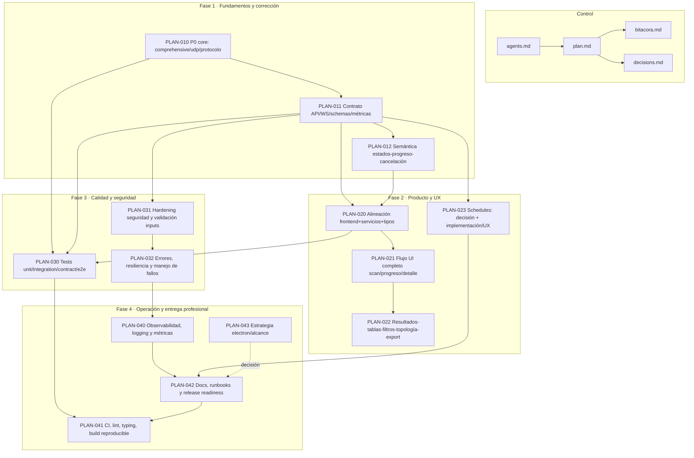

# plan.md — Roadmap y grafo de ejecución

> Estado vivo del trabajo. Se actualiza en cada iteración del loop definido en [`agents.md`](agents.md).
> Última actualización: 2026-11-13 (PLAN-021/022/031/032/040/041 cerrados; flujo UI validado, bundle optimizado, observabilidad y resiliencia)

## 1. Visión y objetivo

Elevar **nmap-custom** a un nivel profesional como herramienta de escaneo de redes autorizadas: correcta en resultados, consistente en contratos, segura por diseño, observable, probada, desplegable de forma reproducible y mantenible por equipos/agentes.

## 2. Alcance y principios

- **En alcance:** estabilización del motor y contratos, completitud del flujo de producto (scan → progreso → resultados → export/schedules), calidad (tests/CI/lint/tipos), hardening de seguridad y configuración, observabilidad, DX/documentación y preparación de release.
- **Fuera de alcance inmediato (salvo `DEC`):** multi-tenancy/auth empresarial, marketplace de plugins, detección avanzada de vulnerabilidades, empaquetado `electron/` como entregable principal.
- **Principios:** **TDD obligatorio** (red-green-refactor), cambios incrementales y verificables, contratos explícitos, mínimo privilegio, reproducibilidad (local/Docker), trazabilidad en `bitacora.md` y decisiones en `decisions.md`.
- **Estrategia de pruebas (transversal):** cobertura progresiva de todo el comportamiento con **mocks y fixtures**; pruebas deterministas sin depender de red real, escaneos no autorizados, privilegios root, servicios externos o tiempos no controlados. Usar fixtures para datos/estado/config y mocks/stubs/fakes para sockets/scapy/nmap, Celery/Redis, DB (según nivel), tiempo y WS.
- **Dirección de diseño UI (producto):** look & feel **"consola cyberpunk cyan"** — estética de terminal/hacker futurista con paleta dominante cyan/neón sobre fondos oscuros, tipografía monoespaciada/tech donde aplique, alto contraste, acentos glow/controlados y componentes consistentes con esta identidad (aplicable a Dashboard, configuración, progreso, resultados y visualizaciones). Detallar tokens/componentes en PLAN-020/021.

## 3. Estado base (resumen)

- **Completado:** `PLAN-001` (harness/loop/grafo documental), `PLAN-002` (auditoría backend/core-api-schemas-models-tasks-config con hallazgos P0–P2).
- **Brechas principales:** defectos P0 en modo comprehensivo/protocolo, contrato de progreso/WS inconsistente, métricas ambiguas, schedules sin ejecución automática, cobertura de pruebas/validación insuficiente, alineación frontend-backend incompleta y hardening operativo pendiente.

## 4. Grafo de dependencias (vista Graph)

## 5. Roadmap por fases

| Fase | Objetivo | Criterio de salida |
|---|---|---|
| **F1. Fundamentos y corrección** | Eliminar defectos P0/P1 y fijar contratos canónicos | Escaneos soportados correctos, métricas/progreso/WS consistentes, cancelación y errores predecibles |
| **F2. Producto y UX** | Completar experiencia end-to-end usable | Usuario configura, ejecuta, monitorea, consulta, exporta y (según DEC) programa escaneos desde la UI |
| **F3. Calidad y seguridad** | Asegurar confiabilidad y uso seguro | Suite de pruebas relevante en CI, validaciones/hardening aplicados, fallos manejados con degradación controlada |
| **F4. Operación y entrega profesional** | Hacer el sistema operable y entregable | Observabilidad, pipelines reproducibles, documentación/runbooks, criterios de release cumplidos |

## 6. Backlog priorizado

| ID | Tarea | Área | Estado | Prioridad | Dependencias | Criterio de aceptación | Verificación |
|---|---|---|---|---|---|---|---|
| PLAN-001 | Crear e inicializar artefactos de control (`agents/decisions/plan/bitacora`) | Control | done | Alta | - | Archivos creados, enlazados y con seed inicial | Revisión documental |
| PLAN-002 | Auditar motor, API, schemas, modelos y tareas | Backend/Core | done | Alta | PLAN-001 | Flujo mapeado y hallazgos P0–P2 documentados | Auditoría estática + actualización de control |
| PLAN-010 | Corregir defectos P0 de ejecución de escaneo | Backend/Core | done | Crítica | PLAN-002, DEC-007 | `COMPREHENSIVE` sin `NameError`; protocolo correcto por puerto (tcp/udp); comportamiento UDP definido y probado; sin regresiones en tipos soportados | `pytest tests/core` (28 passed, mocks/fixtures), `py_compile`, sanidad controlada; red real solo en entornos autorizados |
| PLAN-011 | Definir y aplicar contrato canónico API/WS/schemas (v1.0) | Backend+Frontend | done | Crítica | PLAN-002, PLAN-010, DEC-006, DEC-007 | Contrato único para entidades, estados, progreso, métricas, errores y eventos WS; schemas y clientes alineados | `docs/CONTRACT.md` v1.0; resumen/detalle separados; builders de payload WS puros; tipos `ScanWSMessage` en frontend; `pytest tests/api tests/core` → **58 passed** (25 de contrato) |
| PLAN-012 | Normalizar ciclo de vida de scan (estados, cancelación, timestamps, errores) | Backend/API | done | Alta | PLAN-010, DEC-006 | Transiciones válidas (`pending/running/completed/failed/cancelled`), delete/cancel coherente, errores persistidos y expuestos | Tests API lifecycle (mocks/fixtures) + verificación `pytest tests/api tests/core` |
| PLAN-020 | Alinear frontend (tipos, store, servicios REST/WS) al contrato y dirección visual | Frontend | done | Alta | PLAN-011, PLAN-012, DEC-009 | Tipos/servicios reflejan contrato real; manejo de estados y reconexión/errores consistente; tema "consola cyberpunk cyan" aplicado | Tema compartido (`theme.ts`) en Dashboard/Detalle/Diálogo, utilidades con tests, WS tipado; `npm run lint` + `tsc --noEmit` + `npm run build` OK, `vitest run` → **30 passed**; guía en `docs/UI.md` |
| PLAN-021 | Completar flujo UI principal de escaneo | Frontend | done | Alta | PLAN-020 | Configurar, iniciar, monitorear progreso y ver detalle/resultados de forma usable | Flujo completo: creación con validación local, progreso WS, cancelación desde detalle, estados vacíos y navegación. **Validación funcional con pruebas de componentes** (jsdom + Testing Library, API/WS mockeados): `ScanDialog` (validación, envío, error), `Dashboard` (listado, vacío, creación), `ScanDetails` (carga, progreso WS, estado terminal, cancelación). `lint`/`tsc`/`build` OK; suite frontend **67 passed**. E2E real con backend queda condicionado a entorno autorizado (DEC-004) |
| PLAN-023 | Schedules: definir estrategia y cerrar flujo | Full-stack | done | Alta | PLAN-011, DEC-008 | DEC-008 aceptada; ejecución automática implementada **o** alcance limitado explícito en API/UI/docs, sin ambigüedad | **DEC-008 implementada**: despachador idempotente + `croniter`, `next_run_at` en API, Beat cada 60 s (compose sin `cap_add`), contrato §3.5 y UI `/schedules` (CRUD, toggle, runs, próxima ejecución). Backend **82 passed**; frontend **41 passed** (`lint`/`tsc`/`build` OK). Pendiente: disparo real en entorno autorizado |
| PLAN-022 | Completar resultados, filtros, visualización y export en UI | Frontend | done | Media | PLAN-021 | Tablas/filtros/topología/export coherentes con datos y formatos soportados | `/results`: selector de scan, tabla plana host/puerto, búsqueda y filtros por estado/protocolo/servicio, contadores y export JSON/CSV/XML con nombre determinista; utilidades puras **11 tests**. **Code-splitting:** rutas lazy (`ScanDetails`, `ResultsBrowser`, `Schedules`) y chunks manuales (react/mui/router/http/state/vendor); mayor chunk **241 kB** (sin aviso >500 kB). `lint`/`tsc`/`build` OK y suite frontend **67 passed** |
| PLAN-030 | Establecer estrategia de pruebas TDD (mocks/fixtures, base operativa) | QA | done | Alta | PLAN-010, DEC-010 | Estrategia y harness TDD operativos: mocks/fixtures, configuración pytest, suite core automatizada en verde y patrón replicable; expansión de cobertura a API/tasks/WS/frontend continúa en planes funcionales | `python -m pytest tests/core -q` → 28 passed (con `PYTHONPATH=.`, `DATABASE_URL=sqlite:///:memory:`) |
| PLAN-031 | Hardening de seguridad y validación de entradas/config | Security/Backend | done | Alta | PLAN-011 | Validación estricta de targets/puertos/opciones, límites de recursos, manejo seguro de capacidades/permisos, CORS/config por entorno, sin secretos expuestos | **Completado:** `core/validation.py` (IP/CIDR/rango/hostname y puertos 1–65535) aplicado a `ScanCreate` y `scan_config`; límites `MAX_HOSTS_PER_SCAN=1024`/`MAX_PORTS_PER_SCAN=65535` con rechazo `422` (sin truncado); CORS exige orígenes explícitos y rechaza `*`; `SECRET_KEY` placeholder detectado con warning en producción; compose solo con `NET_RAW`/`NET_ADMIN` en backend/celery y `beat` sin capacidades. Backend **162 passed**; frontend **67 passed** (`lint`/`tsc`/`build` OK) |
| PLAN-032 | Resiliencia y manejo de errores | Backend/Frontend | done | Media | PLAN-012, PLAN-031 | Timeouts/reintentos acotados, degradación controlada, mensajes de error útiles y no sensibles, idempotencia donde aplique | **Completado:** timeout por scan (`DEFAULT_SCAN_TIMEOUT`, `ScanTimeoutError`), idempotencia sobre estados terminales (`skipped`), aislamiento de fallos por host (`hosts_failed`) y `RESOLVE_HOSTNAMES` configurable; errores `500` genéricos con traceback solo en logs, mensajes persistidos truncados/seguros y errores de DB enmascarados. Tests: `test_resilience.py` (**9**) y `test_error_handling.py` (**3**); backend **190 passed** en ~2.4 s (sin DNS real) |
| PLAN-040 | Observabilidad y operabilidad | Infra/Backend | done | Media | PLAN-032 | Logging estructurado consistente, correlación de scans/tareas, healthchecks útiles y métricas básicas de operación | **Completado:** `core/logging_utils.py` (JSON por línea, `ScanLoggerAdapter` con `scan_id`/`task_id`, `configure_logging` idempotente, `exc_info` tolerante); `tasks.py` emite `scan.started/completed/failed/not_found/progress_error`; `api/system.py` con `/api/health` (`SELECT 1`, `503` degradado) y `/api/metrics` (conteos por estado, activos, hosts/ports totales); `HEALTHCHECK` del Dockerfile sin `requests`. Tests: `test_logging_utils.py` + `test_system.py` (**13**); backend **175 passed**. Docs: contrato §3.6/§3.7 y `docs/OBSERVABILITY.md` |
| PLAN-041 | Pipeline de calidad reproducible (CI/DX) | Infra/QA | done | Alta | PLAN-030 | Checks automatizados (lint, type/build, tests) y entorno reproducible documentado; pasos claros para dev/prod | **Completado:** `scripts/verify.ps1`/`scripts/verify.sh` (backend pytest con SQLite in-memory por defecto, frontend lint/typecheck/`vitest run`/build, `--skip-build`); `make check`/`make verify`; scripts `typecheck` y `test:run`; workflow `.github/workflows/ci.yml` (Python 3.11/Node 20) y `docs/CI.md`. Verificación: `verify.ps1` → **All checks passed** (backend **162**, frontend **67**, build OK) |
| PLAN-042 | Documentación profesional y runbooks | Docs | todo | Media | PLAN-023, PLAN-040, PLAN-041 | README/API/config/deploy/troubleshooting/runbooks actualizados, limitaciones conocidas y guía de operación segura | Revisión cruzada docs vs comportamiento real |
| PLAN-043 | Decidir y acotar estrategia de `electron/` | Producto/Infra | todo | Baja | PLAN-001 | DEC explícita: implementar, aplazar o retirar del alcance activo; plan/grafo ajustados | `DEC-xxx` + actualización de backlog |
| PLAN-050 | Criterios de release y hardening final | Release | todo | Media | PLAN-022, PLAN-023, PLAN-030, PLAN-031, PLAN-032, PLAN-041, PLAN-042 | Checklist de release aprobado, versiones/tagging, configuración prod segura, smoke tests y rollback básico documentados | Dry-run de release + verificación de checklist |

## 7. Hallazgos de auditoría incorporados (PLAN-002)

- **Flujo real:** API crea/encola scan, Celery ejecuta core y persiste progreso/resultados, WS actualiza por polling de DB, export/listado/detalle disponibles, schedules CRUD sin motor de disparo detectado.
- **P0:** `COMPREHENSIVE` con `udp_common` no definido y protocolo UDP mal etiquetado en resultados combinados.
- **P1:** contrato de progreso/callback inconsistente, WS polling/broadcast no unificado y frágil ante ausencia de scan, métricas/progreso con semántica ambigua, schedules sin ejecución automática.
- **P2:** cancelación no persistida coherentemente en delete, listados potencialmente pesados, heurísticas UDP/discovery mejorables, opciones/config no aplicadas efectivamente.
- **Decisiones abiertas derivadas:** `DEC-006` (progreso/tiempo real), `DEC-007` (semántica de ejecución y métricas), `DEC-008` (schedules).

## 8. Definición de profesionalización (DoD de programa)

Se considerará el objetivo alcanzado cuando:
- [ ] P0/P1 críticos resueltos y cubiertos por pruebas automatizadas (TDD, mocks/fixtures).
- [ ] Comportamiento soportado cubierto progresivamente por pruebas deterministas (objetivo: cobertura total del alcance definido).
- [ ] Contratos API/WS/schemas/documentación alineados y versionados por cambios relevantes.
- [ ] Flujo principal de usuario completo y estable (incl. decisión explícita sobre schedules).
- [ ] Validaciones de seguridad, límites y manejo de privilegios documentados y aplicados.
- [ ] CI/checks reproducibles en verde para el alcance definido.
- [ ] Observabilidad y runbooks suficientes para operar y diagnosticar.
- [ ] Criterios de release cumplidos y trazabilidad completa en `plan/decisions/bitacora`.

## 9. Riesgos y supuestos

- **Privilegios y entorno:** scans SYN/OS/raw pueden requerir capacidades/root y variar entre Windows/Linux/Docker.
- **Alcance legal:** validación dinámica únicamente en redes autorizadas/entornos controlados (`DEC-004`).
- **Deriva de contrato:** cambios en core/API impactan frontend y export; gestionar con `DEC` y tests de contrato.
- **Coste de descubrimiento/escaneo:** heurísticas agresivas pueden generar falsos positivos, lentitud o carga; aplicar límites y perfiles.
- **Dependencias externas:** disponibilidad de Redis/DB/nmap/libpcap/toolchains condiciona verificación integral.

## 10. Próxima iteración (loop slice)

1. **PLAN-042:** runbooks de operación (troubleshooting, timeouts/errores, schedules) y documentación de release.
2. **PLAN-050:** checklist de release, versionado/tagging, dry-run de smoke tests y rollback básico.
3. **PLAN-023 (validación):** disparo real de un schedule en entorno autorizado (DEC-004).
4. **Observabilidad (deuda):** nivel de log configurable por entorno y exportador Prometheus/OpenTelemetry si se requiere.
5. **Salida esperada:** operación observable y documentada, release checklist aprobado y flujo validado en entorno autorizado.

## 11. Historial de cambios del plan

- **2026-11-11:** creación inicial del plan, grafo de dependencias y backlog seed (PLAN-001 completado, PLAN-002..007 definidos).
- **2026-11-11:** completado **PLAN-002** (auditoría). Añadidos flujo real, discrepancias P0–P2, contratos detectados y slice hacia PLAN-003.
- **2026-11-11:** redefinido roadmap a nivel profesional: visión, fases F1–F4, grafo ampliado, backlog reestructurado (`PLAN-010+`, `PLAN-020+`, `PLAN-030+`, `PLAN-040+`, `PLAN-050`), DoD de programa y nuevo slice de ejecución.
- **2026-11-11:** adoptado TDD con mocks/fixtures (DEC-010). Completados **PLAN-010** (fixes P0 core + semántica baseline, DEC-007 accepted) y **PLAN-030** (estrategia/harness y suite core 28 tests en verde). Próximo foco: PLAN-011/012/020.
- **2026-11-11:** avance **PLAN-011/012/020** — baseline de contrato tiempo real/lifecycle (DEC-006 accepted), cancelación coherente en API, WS robustecido (payload/error), fallback de Celery para testabilidad, tema frontend "consola cyberpunk cyan" aplicado en base, y tests backend `api+core` en verde (33). **PLAN-012** cerrado; **PLAN-011/020** en progreso.
- **2026-11-11:** avance **PLAN-011** — separación de contratos `ScanSummaryResponse` (listado) vs `ScanResponse` (detalle), alineación frontend (`results` opcional, manejo `ports_found`/`error_message`/eventos `error` en WS), mejoras de testabilidad WS y nuevos tests de contrato HTTP (`backend/tests/api/test_scan_contract.py`). Verificación: `pytest tests/api tests/core` → 35 passed. Tests WS añadidos pendientes de estabilización de ejecución en este entorno.
- **2026-11-11:** **PLAN-011 cerrado** — contrato v1.0 en `docs/CONTRACT.md`; builders puros de payload WS (`build_status_message`/`build_update_message`/`build_error_message`), cierre explícito del socket en estados terminales; suite de contrato ampliada (`TestScanContract`, `TestSchemaContract`, `TestWebSocketMessageBuilders`, `TestWebSocketContract`) → **58 passed** (`tests/api tests/core`). Frontend alineado con `ScanSummary`/`ScanWSMessage` y cliente WS endurecido (pong, sin reconexión en cierre intencional/terminal). Siguiente foco: PLAN-020/021 y DEC-008.
- **2026-11-11:** avance **PLAN-020** — deps frontend instaladas (`npm ci`), corregidos imports sin uso en `ScanDetails`, `tsc --noEmit` y `npm run build` en verde, y suite `vitest` (config en `vite.config.ts`) con 6 pruebas del cliente WS (URL, heartbeat, parseo, pong, no-reconexión terminal/intencional, reconexión). `npm run lint` no ejecutable: no existe configuración ESLint.
- **2026-11-11:** **PLAN-020 cerrado** — tema extraído a `theme.ts` y propagado a Dashboard/Detalle/Diálogo; utilidades compartidas (`utils/scan`, `utils/validation`, `utils/errors`) con 24 pruebas; configuración ESLint (`.eslintrc.cjs`) y `npm run lint` en verde; guía visual `docs/UI.md`. **PLAN-021** en progreso: validación local del formulario, cancelación desde detalle, estados vacíos y refactor de efectos/WS sin warnings. **DEC-008 accepted** (Celery Beat + despachador DB idempotente, fases en la decisión) para PLAN-023. Verificación: `lint`/`tsc`/`build` OK, `vitest run` → **30 passed**.
- **2026-11-11:** **PLAN-023 cerrado (fases 1–3)** — despachador DB idempotente + `croniter`, `next_run_at` en `/api/schedules`, task Beat cada 60 s, servicio `beat` en compose sin capacidades, contrato §3.5 y UI `/schedules` (listado, alta/edición validada, toggle, borrado con confirmación, contadores y próxima ejecución UTC). Verificación: backend **82 passed**; frontend `lint`/`tsc`/`build` OK y `vitest run` → **41 passed**. Siguiente foco: validación funcional de PLAN-021 y PLAN-022/031/041.
- **2026-11-12:** **PLAN-022 cerrado** — navegador `/results` con selector de scan, tabla plana host/puerto, búsqueda libre y filtros por estado/protocolo/servicio, contadores de hosts/puertos y export JSON/CSV/XML vía API con descarga determinista. Utilidades puras `utils/results.ts` con **11 pruebas** (TDD rojo→verde). Verificación frontend: `lint`/`tsc`/`build` OK y `vitest run` → **52 passed**. Deuda: bundle principal ~529 kB (code-splitting pendiente). Siguiente foco: validación funcional de PLAN-021 y PLAN-031/041.
- **2026-11-12:** avance **PLAN-031 (validación)** — `app/core/validation.py` con `normalize_target` (IPv4/IPv6, CIDR, rango IPv4, hostname sin resolución DNS) y `normalize_port_range` (listas/rangos 1–65535, orden y tokens), aplicados a `ScanCreate` y `scan_config` de `ScheduleCreate`/`ScheduleUpdate`. Tests TDD: `tests/core/test_validation.py` (**40**) y `tests/api/test_input_validation.py` (**22**); suite backend completa → **144 passed**. Pendiente: límites de recursos, CORS/capacidades y secretos.
- **2026-11-13:** **PLAN-031 cerrado** — límites `MAX_HOSTS_PER_SCAN=1024`/`MAX_PORTS_PER_SCAN=65535` aplicados a CIDR/rangos y listas de puertos (rechazo `422`, sin truncado); CORS solo con orígenes explícitos (rechaza `*`/lista vacía) y límites positivos validados en `Settings`; `SECRET_KEY` placeholder detectado (`uses_default_secret`) con warning de arranque en `ENV=production`; revisión de compose: backend/celery solo `NET_RAW`/`NET_ADMIN`, `beat` sin capacidades. Tests: `tests/core/test_config.py` nuevo; validación UI alineada (rangos IPv4 y límite 1024). Verificación: backend **162 passed**, frontend **54 passed**, `lint`/`tsc`/`build` OK. Contrato §3.1/§6 y README actualizados.
- **2026-11-13:** **PLAN-041 cerrado** — pipeline reproducible: `scripts/verify.ps1` y `scripts/verify.sh` (backend pytest, frontend lint/typecheck/`vitest run`/build, `--skip-build`), targets `make check`/`make verify`, scripts npm `typecheck`/`test:run`, workflow `.github/workflows/ci.yml` (Python 3.11 + Node 20) y runbook `docs/CI.md`. `tests/conftest.py` fija `DATABASE_URL=sqlite:///:memory:` para ejecución sin entorno. Verificación: `verify.ps1` completo → **All checks passed** (backend **162**, frontend **54**, build OK).
- **2026-11-13:** **PLAN-021 cerrado** — validación funcional del flujo UI con **pruebas de componentes** (jsdom + Testing Library, API/WS mockeados): `ScanDialog` (validación de target/límites, envío y error), `Dashboard` (listado, vacío y creación end-to-end del diálogo), `ScanDetails` (carga, progreso WS, recarga en estado terminal y cancelación). Alineado el límite total de puertos en UI (65535) con backend. Verificación: frontend **67 passed**, `lint`/`tsc`/`build` OK. E2E real condicionado a entorno autorizado (DEC-004).
- **2026-11-13:** **deuda PLAN-022 resuelta** — code-splitting del frontend con `React.lazy`+`Suspense` para `ScanDetails`/`ResultsBrowser`/`Schedules` y `manualChunks` (react/router/mui/mui-icons/http/state/vendor). Build sin aviso de chunk: mayor **241 kB** (mui) y entrada **23.9 kB**; verificado `lint`/`tsc`/`build` y **67 tests** en verde.
- **2026-11-13:** **PLAN-040 cerrado** — `core/logging_utils.py` (JSON por línea, `ScanLoggerAdapter` con `scan_id`/`task_id`, `configure_logging` idempotente y resolución robusta de `exc_info` para Python 3.14); `tasks.py` emite eventos correlacionados (`scan.started/completed/failed/not_found/progress_error`); `api/system.py` con `/api/health` (SELECT 1 → `503` degradado) y `/api/metrics` (conteos por estado, activos y totales); `HEALTHCHECK` del Dockerfile sin `requests`. Verificación: `test_logging_utils.py`+`test_system.py` (**13**) y backend **175 passed**. Docs: contrato §3.6/§3.7, `docs/OBSERVABILITY.md` y README.
- **2026-11-13:** **PLAN-032 cerrado** — `execute_scan` con timeout (`DEFAULT_SCAN_TIMEOUT`), idempotencia (skip de estados terminales), persistencia segura de errores (truncado 500, DB enmascarada) y aislamiento de fallos por host; `RESOLVE_HOSTNAMES` configurable y DNS inverso desactivado en tests; handler global `500` genérico. Verificación: `test_resilience.py` (**9**) + `test_error_handling.py` (**3**); backend **190 passed** en ~2.4 s.
